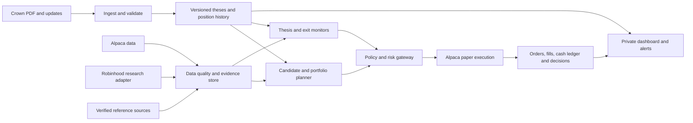

# 13 - Completion plan: autonomous paper trading and private dashboard

Proposed implementation plan, 2026-10-19. Read with docs 01-12 and the provider research
in [doc 14](14-robinhood-and-data.md). This records the user's latest priority: build a
reliable autonomous paper system; use historical replay where defensible, without making
an exhaustive backtest a prerequisite. It does not enable orders or change runtime limits.

## Outcome

A service on a cloud VPS receives Crown letters, identifies their theses and bets,
selects the closest permissible expression inside a $5,000 settled-cash-only sleeve,
maintains exits between letters, and explains every action in a private website.

Crown supplies direction and economic intent. We optimize implementation under hard
constraints and a minimum fidelity requirement. We cannot promise an optimal return or
infer that a high-correlation instrument preserves an options trade's payoff.

The end state is autonomous operation within an owner-configured permission envelope.
Paper autonomy and live autonomy have separate policies. The service cannot promote
itself, enable live trading, expand its universe, or relax its limits.

## Evidence at handoff

- Baseline pushed to GitHub as `ff23ba9`; 57 tests passed on 2026-10-19.
- The local corpus now contains 20 letter PDFs through October 19 plus the base guide.
  All 21 source PDFs are ignored and none are tracked; older docs still refer to 17 letters.
- OpenAI thesis-first extraction and inventory commands exist, as does a GET-only Alpaca
  probe. The existing tests cover prototype behavior and some extraction plumbing.
- The execution models, compiler, replay runner, and gateway are still v1. There is no
  deployed trading service, web app, real order adapter, or validated thesis lifecycle.
- The gateway currently blocks every order under HALT, including exits. It has no settled
  cash ledger, complete portfolio risk controls, or enforceable stop ratchet.
- The extractor stores a PDF hash but does not check it before returning cached content.
  Position linking is heuristic; source/number validation is incomplete.
- Symbol rendering was suspected to be damaged at handoff. UTF-8 inspection subsequently
  found no control/replacement-character corruption in the glossary; do not rewrite it
  based on PowerShell display encoding alone.
- No provider credentials were tested and no orders were sent during this handoff.

Passing the prototype suite does not establish paper readiness.

Subsequent Phase 0 evidence: OpenAI and read-only Alpaca paper checks succeeded. Robinhood
OAuth remains incomplete and is optional for work Alpaca can support. The first letter
extraction cost an estimated $0.175 at published GPT-5 token rates and failed its page audit.
Critical omissions/misreadings and incorrect assumptions in the inherited worked examples
are recorded privately; the examples above are historical handoff context. Do not bulk
extract or treat the old fixture as gold until extraction corrections pass review.

Current result: v3.1 extractions for June 1, June 22 and October 19 have been visually
reviewed across all pages, corrected with explicit source provenance, and checked against
32 recorded critical facts. The offline results preview contains 19 position/setup rows
(including a separate contingent addition), plus lifecycle updates and macro theses.
The raw extractions are preserved and still have errors; no claim of full-field accuracy,
automatic parsing readiness or profitable backtesting follows from the corrected sample.
Four recorded API extraction attempts cost an estimated $0.80 at verified GPT-5 rates.
The remaining 17 letters are not extracted in the current version. Reliable automated
verification, complete inventory, reference coverage and subsequent phase gates remain due.

## Architecture and boundaries

Recommended implementation: Python domain engine, SQLite with migrations and an append-only
event/decision journal, FastAPI with server-rendered pages and small interactive controls.
Use one trading worker, a separate web process, and an independent watchdog under systemd.
The website observes and submits authenticated commands; it never submits broker orders.
The web and LLM receive no Alpaca credentials; only the execution interface exposes order
mutations. A GET-only watchdog may require credentials if scoped broker keys are unavailable;
its access boundary must be described accurately. Robinhood is a research adapter with an
explicit read-tool allowlist; it has no order route in this product.

This keeps the small-account operational cost and maintenance load low. Revisit a separate
frontend or database only if the single-owner application actually needs them. Do not put
private letters, extracts, news archives, account probes, or credentials into GitHub.

## Initial paper scope

Start with long stocks, long ETFs, and verified unleveraged inverse ETFs whose exposure
matches an explicitly directional Crown thesis. Use whole shares with proven broker-side
protection first. Add fractional quantities as soon as stop placement, DAY expiry/renewal,
quantity handling, and failure recovery pass instrument-specific tests.

Options are a later release: fully paid long calls/puts first, with expiry/exercise
cutoffs that prevent automatic exercise into unaffordable shares; debit spreads only if
the account, no-margin policy, order lifecycle, and data quality support them. Leveraged
products, relative-value pairs, unsupported reference markets, and materially different
payoff shapes remain skips until separately validated. Prediction markets stay deferred.
These are temporary capability gates, not permission to convert every Crown idea into an
ETF trade. Report how much of Crown's book the initial release cannot express.

## Phase 0 - Verify the inputs and capabilities

Establish CI for the offline suite, dependency compatibility, and tracked-file checks
that reject private PDFs, credential files, and runtime artifacts. Keep the existing
$10-25/month operating target visible; measure API usage, cache aggressively, and require
a cost decision before adding paid data or high-frequency model calls.

1. Update the probe for the current Alpaca API/SDK. Deprecated fields must not break it.
   Report broker account classification separately from our cash-only policy; a multiplier
   of 1 is not proof of a legal cash account. No account configuration changes in a probe.
2. Use paper credentials for read-only account, asset, feed, and news checks. Verify
   actual instrument flags, quote timestamps, options entitlements, order capabilities,
   account restrictions, and activity/settlement reporting. Do not treat buying power or
   raw cash as settled cash. Paper observations cannot certify live capabilities.
3. Pin compatible dependency versions and model configuration. Check one OpenAI request,
   then extract and hand-verify June 22 plus two different layouts. Verify glossary
   symbols against the source, validate critical numbers, then inventory the remaining local letters in
   bounded batches with token/cost reporting. Do not send the whole library on retries.
4. Prototype the Robinhood read-only connection described in doc 14. Record actual tool
   availability and data limitations. Failure to connect need not block instruments that
   Alpaca alone can adequately monitor.
5. Select reference coverage per thesis: equity/index, commodity future, currency pair,
   macro release. An unavailable required reference is a skip, not an unlogged proxy.

Exit evidence: three audited extractions, full inventory with unresolved issues visible,
capability/data matrix, measured extraction usage, and explicit paper-vs-live unknowns.
This is the point at which remaining risk parameters are proposed from real observations;
existing defaults remain provisional and are not silently changed.

## Phase 1 - Reliable letter and state model

- Use content hashes plus schema/prompt/model versions for cache identity. Persist receipt,
  publication, effective, extraction, and correction timestamps separately.
- Validate instrument units, option multipliers, sign conventions, numerical bounds,
  price-vs-premium fields, arithmetic, and page references. Critical ambiguities block
  affected plans; schema-valid output alone is insufficient.
- Assign stable thesis and Crown-position IDs across letters. Handle renames, rolls,
  reductions, closures, and multiple structures on the same ticker without merging them.
- Detect partial/corrupt extractions and missing issues before interpreting absence as a
  silently dropped position. A missing section is not evidence that Crown sold.
- Store corrections as new audited versions; never rewrite the history of a decision.

Exit evidence: consistent position histories and audited critical fields with no errors
in prices, strikes, triggers, or multipliers. Add targeted tests for ambiguity and linking.

## Phase 2 - Faithful expressions and account-aware allocation

- Build the exposure profile and candidate catalog from docs 04-05. Resolve candidates
  against actual tradable assets. Include skip in every result.
- Apply payoff, direction, event, horizon, liquidity, capability, and reference-data gates
  before scoring. A short-volatility thesis does not become a directional ETF bet merely
  because that ETF is affordable. Same-expiry option parity can sometimes preserve a
  credit spread's economic payoff in a debit wrapper; establish that from exact strikes,
  quotes, carry/dividends, and exercise risk rather than a blanket structure lookup.
- Compare candidates using normalized costs and fidelity measures. Use scenario exposures
  for flat markets, rallies, selloffs, volatility changes, and event gaps; correlation
  alone cannot establish equivalence. Show preserved and lost properties, not just a score.
- Size before submission using a bounded executable price and slippage allowance. Reserve
  cash and open risk transactionally across pending orders. Reconcile actual partial fills
  and reduce excess exposure if necessary; a fill price cannot be known before execution.
- Use Decimal quantities/currency and instrument precision rules. Track thesis/cluster
  concentration, total deployed capital, gross exposure, gap stress, and risk to stop.
  Risk to stop is an estimate, not a maximum possible loss. Long options are sized on
  premium at risk, without assuming an underlying stop caps premium loss.
- Treat hedged legs as a package. Closing a hedge is not automatically risk-reducing;
  measure the resulting portfolio, and use a prescribed package unwind if needed.

Exit evidence: an auditable expression or skip for every inventoried Crown position,
feasible cash/reservation accounting, and scenario-based evidence for each allowed family.

## Phase 3 - Thesis monitoring and exits

- Separate Crown-stated invalidation from our quantitative protection. An ATR exit limits
  exposure; it does not prove that Crown's macro thesis became false.
- Track active, weakened, invalidated, and unknown/stale evidence states. Absence of a
  headline is never evidence that a thesis remains sound. Monitor price, news, event
  outcomes, and refresh deadlines for the actual assumptions behind each held thesis.
- Give every condition units, an observation source, timestamp, freshness bound, action,
  and escalation deadline. Event comparisons use the release/vintage available then.
  Gamma walls, positioning observations, and correlations expire; weekly values cannot
  be presumed current indefinitely.
- Broker protection does not wait for the scheduler. Use streaming/short-cadence checks
  for agent-dependent exits; the old hourly base cadence is not adequate protection.
  Test market holidays, halts, after-hours gaps, and session boundaries. Regular-hours
  execution is the initial scope; overnight/event risk must be explicit in each plan,
  and no broker stop is assumed active in sessions its order type does not support.
- Hard price/risk exits run without an LLM. Narrative reviews return structured proposals
  with cited evidence; they cannot add risk. A failed review freezes affected entries and
  follows the approved timeout policy while existing protection remains active.
- Implement letter reconciliation and dropped-position policy. Only a complete comparable
  issue can establish a silent drop. A Crown closure affects our held expression promptly.
- Ratchet protection in execution space. Re-estimating an ETF ratio or beta cannot loosen
  an existing stop. Freeze entries if translation/reference quality deteriorates.
- Separate emergency protection from experimental ATR/trailing/time/event optimizations.
  A position lacking a Crown exit must have an explicit approved fallback or be skipped.
  Discretionary overlay tuning stays in shadow until supported by replay or forward data.

Exit evidence: every open position has a testable exit plan and a defined response to
missing data, missed letters, review failures, and service outages.

## Phase 4 - Evaluation sufficient for paper

Required before connecting order execution:

- Deterministic scenarios for trigger timing, late letter arrival, thesis breaks,
  multi-session conditions, silent drops, pending orders, holiday settlement, stale feeds,
  duplicate events, HALT with an open position, and crash/restart around a fill.
- Verify stops/targets within the same bar conservatively; market exits use the executable
  price, not a historical stop level. No future bars, articles, revised releases, or later
  letter closures enter earlier decisions.
- Replay the audited letters where defensible equity/ETF data exists. Label assumptions
  and unsupported outcomes. Historical option bars do not establish executable spreads.
- Start Crown-reported, feasible-replica, and actual tracking with explicit missing data.
  Attribution uses a fixed counterfactual order and reports interaction/unexplained effects;
  substitution, sizing, and overlays are not inherently independent additive causes.

A complete four-month, cross-asset historical backtest is optional research. Its absence
does not prevent paper if these operational gates pass. Historical LLM judgments remain
non-causal research unless reproducible without model hindsight; use deterministic replay
stand-ins and recorded forward decisions for the primary evidence.

## Phase 5 - Paper adapters, deployment, and website

Only after Phases 0-4 gates pass:

- Add an Alpaca paper adapter behind the gateway. Validate endpoint/account identity at
  startup; paper mode cannot select a live URL through a casual environment change.
- Implement durable order intents, unique client IDs, single-writer execution, retries
  that reconcile before resubmitting, partial fills, rejects, and cancel/replace races.
  Broker positions/open orders are reconciled on startup and before new risk.
- Confirm protective-order acceptance and quantity after each fill. If protection fails,
  cancel unfilled quantity and apply the approved corrective unwind policy; freeze new
  entries and alert. Never describe a proposed stop as an accepted broker order.
- HALT blocks added exposure while allowing genuine risk reductions. Do not allow a sell
  to exceed available holdings or leave an option package with uncovered short legs.
- Ingest incoming PDFs with receipt times, initially by authenticated upload and watched
  private folder; add a Gmail read-only ingest adapter and reconnect handling. Telegram
  sends receipts/alerts and accepts authenticated policy-scoped commands. YouTube remains
  a lower-authority review input and never originates a new thesis.
- Deploy worker/web/watchdog services with TLS, authenticated private access, encrypted
  backups, restore drills, structured logs, heartbeat alerts, and restart reconciliation.
  A process with GET-only software access is not the same as a broker-issued read-only key;
  do not assume Alpaca offers scoped retail keys without verifying it.

The first website includes:

- Overview: PAPER banner, effective permission policy, account reconciliation, cash reserved
  and settled, exposure, loss limits, service and provider health.
- Thesis view: Crown's claim, source page, our expression, alternatives, fidelity losses,
  evidence freshness, current status, exit rules, and actual broker protection.
- Decisions: entries/exits/skips, input snapshots, policy/config versions, approvals, and
  order/fill timelines. Private PDF pages are accessible only after authentication.
- Operations: upload/review/correct an extraction, inspect failed jobs, approve a bounded
  proposal where required, pause new entries, and request a separately confirmed flatten.
  Persist commands for the gateway; require CSRF protection and an audit event.
- Evaluation: coverage, skipped risk units, benchmark quality, costs, and known shortfall.

This is an operational console, not a website whose browser tab must stay open to trade.
Dashboard/web failures must not stop the independent worker or broker protection.

## Phase 6 - Forward evidence and bounded paper autonomy

Run observer/shadow mode first, then activate an explicit paper-only policy for validated
categories. Within that fixed envelope, ingestion, planning, entries, monitoring, exits,
and reconciliation run unattended with notifications. Exceptions become skips or holds;
they do not require routine phone replies to keep the system operating safely.

Keep live policy at L0. Paper autonomy does not count as automatic promotion of live
permissions. Record decisions and permitted data snapshots from the first day so future
replay reflects information actually available at the time. Review weekly extraction
accuracy, stop coverage, data failures, fidelity, skipped trades, and execution outcomes.
Retain the 4-8 week paper soak before considering live, with no guardrail-relevant errors.
Paper fills are simulation evidence, not proof of live liquidity or profitability.

## Phases 7-8 - Separate live launch and earned autonomy

Follow doc 07: explicit owner authorization, verified live capabilities, recovery drills,
L0 live entries first, then category promotion from recorded evidence. Changing an API
key alone must not activate live trading. No live launch is authorized by this plan.

## Paper-ready declaration

I will call the system ready for autonomous paper only when:

- Phase 0 inputs/capabilities and the allowed paper categories are verified.
- Critical extraction/linking checks and Phases 1-4 scenarios pass.
- The paper account is limited to a $5,000 strategy sleeve even if the simulator offers more.
- Pending orders cannot overspend settled cash or risk; restarts cannot duplicate orders.
- Broker protection, HALT, loss limits, and recovery paths work on the actual paper API.
- The service, dashboard, alerts, and watchdog are deployed and one full letter-to-exit
  workflow has been observed, including a forced failure/restart scenario.

Paper API keys can be added to the ignored `.env` for the Phase 0 GET-only checks now.
Keep `ALPACA_PAPER=true`; do not send keys in chat. First implementation task: update and
harden the probe, dependency pins, and configuration validation, then run the account
verification and audited extraction. No order submission is needed for that task.
